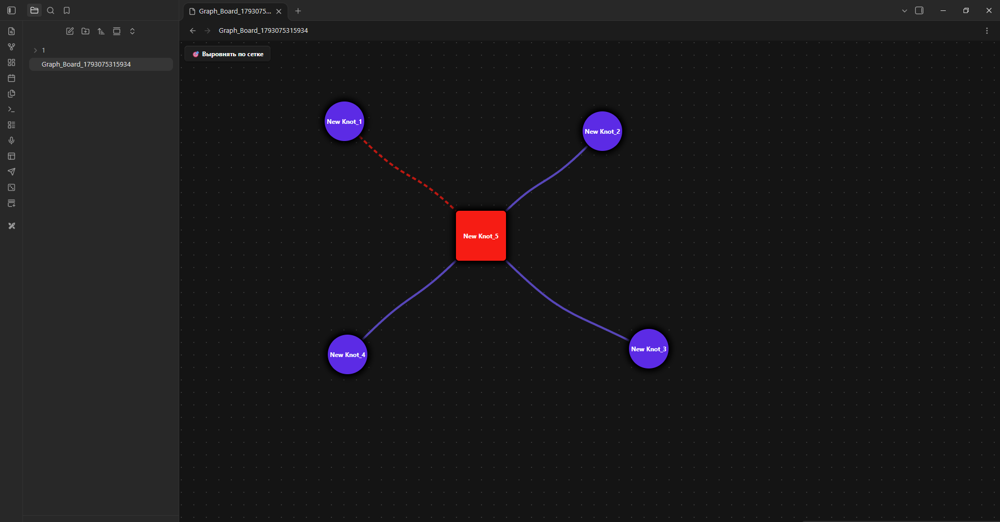

# Custom Graph Board & Tactical Grid 🚀

**Custom Graph Board & Tactical Grid** (v1.0.0) transforms your Obsidian notes into an interactive visual command center. Powered by 16-point adaptive splines, a smart image cropper, and automatic grid alignment, it takes your knowledge mapping to a tactical level.

Developed with 🧠 by **Caractorium Siberian Tactical Engineers**.

---

## 📺 Video Demonstration (Demo)
<video src="media/demo.mp4" width="100%" controls></video>

## 📸 Interface Screenshots

---

## ✨ Key Features

* **Adaptive Splines** — 16-point flexible connections between your note nodes.
* **Smart Image Cropper** — Crop and embed images directly inside your graph asset boards.
* **Tactical Grid Alignment** — Clean, automatic alignment for structured mind-mapping.
* **Cross-Platform** — Fully optimized for both Desktop and Mobile experiences.

---

## 🛠 Installation

1. Create a folder named `obsidian-custom-graph-board` inside your vault's plugins directory: `.obsidian/plugins/`.
2. Drop three files there: `main.js` (your compiled code), `manifest.json`, and `styles.css`.
3. Open Obsidian -> Settings -> Community Plugins -> Enable **Custom Graph Board & Tactical Grid**.